

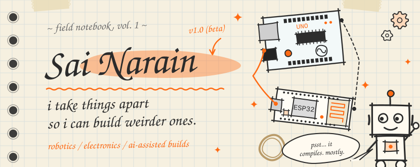

  

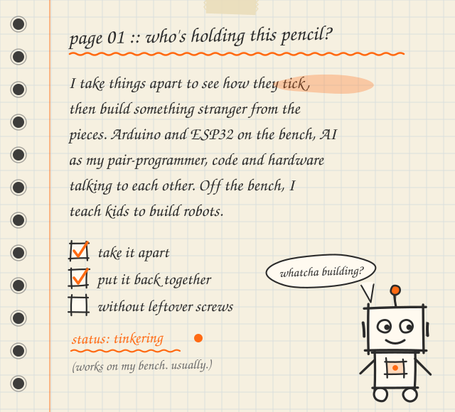

  

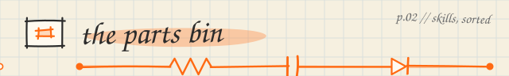

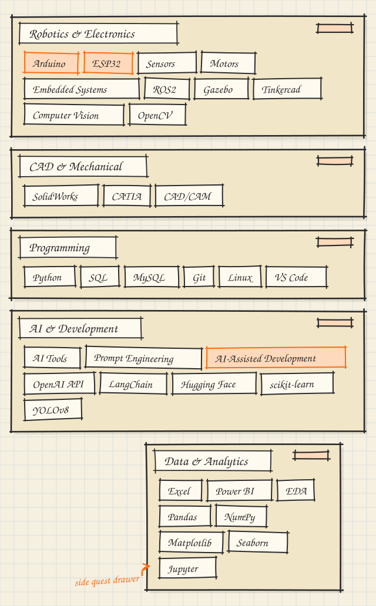

  

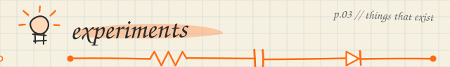

<a href="https://github.com/Narain0024/My-Prompts">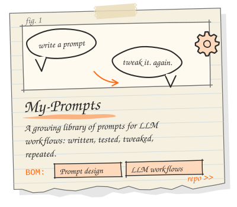</a><a href="https://github.com/Narain0024/my-finance-tracker">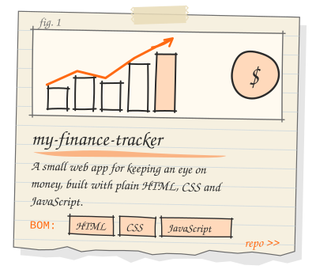</a>

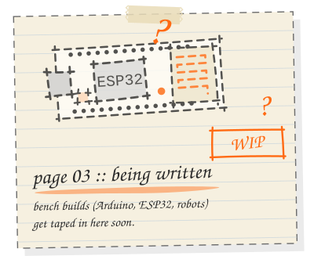

<!--
  ADDING A NEW NOTEBOOK PAGE
  1. Add an entry to tools/projects.py (name, blurb, stack, repo URL, doodle: esp32 | arduino | robot | gear | chart | prompts | finance)
  2. Run:  python3 tools/build.py        (needs: pip install fonttools)
  3. Paste a line like this above, in place of the "being written" page:
     
-->

  

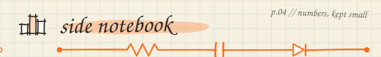

**[IPL-2025-ANALYSIS-EDA](https://github.com/Narain0024/IPL-2025-ANALYSIS-EDA)** &nbsp;·&nbsp; Python, Pandas, Seaborn, Jupyter 
**[silver-price-analysis](https://github.com/Narain0024/silver-price-analysis)** &nbsp;·&nbsp; Python, SQL, Power BI 
**[Student-Performance-Analytics-Dashboard-Power-BI-](https://github.com/Narain0024/Student-Performance-Analytics-Dashboard-Power-BI-)** &nbsp;·&nbsp; Power BI, DAX

 

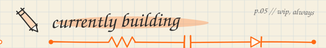

_next experiment loading..._ 
_watch this page; new notebook pages get taped in as the repos go up._

 

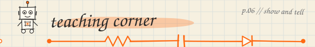

I run **Openhouse Robotics**, a hands-on programme where kids build and program robots, 
from build-only first steps up to Arduino-based programming. 
Curriculum, worksheets and classroom tools get the same treatment as everything else here: 
take it apart, make it better.

 

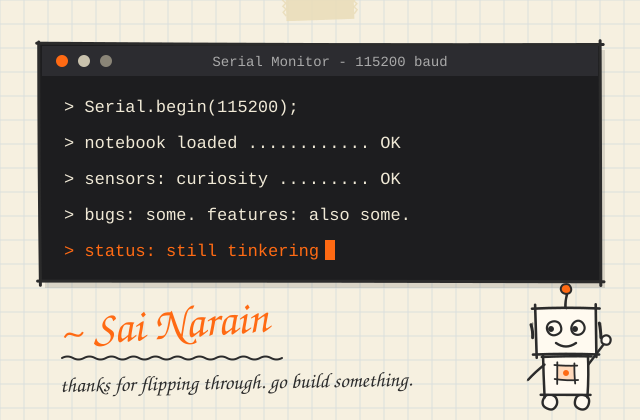

 

<a href="https://linkedin.com/in/sainarainy">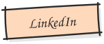</a>
<a href="https://kaggle.com/sainarain">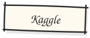</a>

<a href="mailto:narain2442@gmail.com">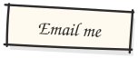</a>

